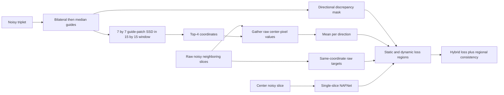
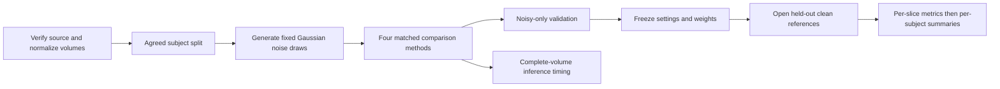

# Project ML: Noisy-Only Volumetric MRI Denoising

CPSC 4430/6430, Fall 2026. Aanand Mani Subedi, Levi Bates, Evan Dang, and Abdul Nasir Abdullah.

This project adapts **Neighbor-Guided Patch Sampling (NGPS)** to a controlled
BrainWeb T1 experiment. The research question is whether guide-based local
matching preserves anatomy better than same-coordinate neighboring-slice
supervision under the same data, noise and compute budget.

**Team repository:** <https://github.com/levib4231/project-ml>

**Original paper:** [Cho and Yoo, NGPS (2026)](https://arxiv.org/abs/2606.23200)

**Authors' original code:** <https://github.com/cv-cho/NGPS>

The team code is a course implementation. Numerical equivalence to the authors'
implementation has not been established. Commands below target GitHub main
inspected at commit `5ae9934f027e3ceb735c7a6135f428495c1960a2` on October 23,
2026. The presentation stays in SharePoint.

## Current evidence and status

| Capability | Status in inspected GitHub main |
|---|---|
| NGPS guide generation, sampling, losses and NAFNet | Implemented; architecture version 2 |
| Gaussian volume preparation | Implemented; explicit normalization and **unclipped** additive noise |
| Agreed 6/2/2 subject IDs | Committed in `NGPS/configs/subjects_v1.json` |
| NLM, masked blind spot, naive adjacent targets and NGPS | Implemented |
| NS-N2N-style objective | Additional local comparator; not a validated external reproduction |
| Synthetic pipeline | Repository evidence log records end-to-end synthetic checks |
| Medical preparation/pilots and benchmark results | Not verified by this revision |
| Source provenance and intensity scale | Require verification before medical runs |
| Confidence-weighted NGPS | Proposed; costs are exposed, but loss weighting is not implemented |
| Course metrics | PSNR, SSIM and normalized HFEN implemented |
| Additional metrics | GMSD and explicitly named `SobelGradientMagnitudeSimilarity`; not FSIM |
| Complete-volume prediction timer | Implemented; includes transfers/assembly, excludes disk I/O and model load |
| End-to-end volume timer including load/save | Course reporting protocol below; separate measurement needed |

The available local checkout is older than GitHub main: its `Data/Noisy` is
empty and it uses legacy folder-based scripts. These new README commands are
for a fresh clone of the current repository, not that older checkout. The
revision does not replace its model code or historical manifests. A historical
`docs/report/checkpoint1_report.md`, if present locally, is superseded by the
revised Word report. Presence of code or a synthetic check does not establish
medical performance. See the existing [synthetic evidence log](NGPS/docs/CHECKPOINT_1_EVIDENCE.md).

## Agreed course protocol

| Item | Decision |
|---|---|
| Planned data source | [BrainWeb: 20 normal-brain anatomical models](https://brainweb.bic.mni.mcgill.ca/brainweb/anatomic_normal_20.html) |
| Training subjects | **04, 06, 18, 41, 42, 43** |
| Validation subjects | **05, 38** |
| Held-out test subjects | **20, 44** |
| Intended corruption | `y = x + epsilon`, `epsilon ~ Normal(0, sigma²)` |
| Noise levels | **sigma = 0.03, 0.06, 0.10**, on normalized `[0,1]` intensities |
| Matched methods | NLM; masked-pixel blind spot; unmasked same-coordinate neighbor; NGPS |
| Deep backbone | NAFNet for all learned objectives |
| Selection | Predeclared final epoch; noisy-only masked validation is monitoring only; freeze before clean test scoring |
| Course metrics | Subject-level PSNR, SSIM, normalized HFEN and complete-volume inference time |
| Proposed improvement | Reduce dynamic-target loss weights for unreliable guide matches |
| Pilot plan | Subject 04, sigma 0.06, 16 center slices, one epoch, batch 1 |
| Compute target | Measure the pilot, then fix an identical workload cap below 10 GPU minutes per deep run |

Generate noise **after** assigning subjects. Keep every slice, patch, adjacent
pair and noise draw with its subject. Reuse the same corrupted observations
across comparison methods. Clean references may generate noisy observations and
score frozen predictions. They must not enter training targets, guides, masks,
validation scores, thresholds or checkpoint selection.

The paper evaluates IXI-T1 MRI with synthetic **Rician** noise labeled
5%/7%/9%; the percentage reference is not fully specified. These levels are not
numerically interchangeable with our Gaussian sigma values. The project is a
course adaptation, and phantom experiments do not establish clinical performance.

## Method and data flow

The diagrams are original explanations adapted from the paper's Fig. 2 and
Section 3. Purple in the slides denotes guides, teal denotes raw targets, and
blue denotes model predictions. All diagram labels remain editable in the deck.



Each NAFNet forward pass takes one 2D slice, never a concatenated triplet.
Training additionally predicts neighboring slices in separate passes for
regional consistency. Inference needs only the trained single-slice denoiser.
Filtered guides select coordinates; target values come from raw noisy neighbors.



### Target construction and training equations

Let `y^z` be the center noisy slice, `g^z = MF(BF(y^z))` its guide,
`f^z = f_theta(y^z)`, and `z'` one of the available neighboring directions.
For direction `z -> z'`, mask value one marks a discrepant location:

$$M_{z\to z'}(p)=\mathbf{1}\{|g^z(p)-g^{z'}(p)|>\tau\}.$$

For a 7 by 7 patch operator `P_7` and a 15 by 15 search window `Omega_p`:

$$D(p,q;z')=\|P_7(g^z,p)-P_7(g^{z'},q)\|_2^2,\qquad q\in\Omega_p.$$

Choose the four coordinates with smallest SSD and retrieve their raw values:

$$t_{z\to z'}(p)=\frac{1}{4}\sum_{k=1}^{4}y^{z'}(q_{(k)}).$$

In a schematic example, raw values 0.61, 0.65, 0.62 and 0.64 produce target
0.630. These values explain the operation; they are not experimental evidence.
The code computes dense candidate costs; the dynamic reconstruction loss uses
retrieved values only where the directional mask is one.

Define the **current local implementation's** normalized masked error:

$$E_m(a,b)=\frac{\sum_p m(p)[a(p)-b(p)]^2}{\max(\sum_p m(p),\epsilon)},\qquad\epsilon=10^{-8}.$$

The sums in code run across the active batch, channel and spatial dimensions.
With angle brackets denoting an average over previous/next directions:

$$\mathcal L_{\rm static}=\langle E_{1-M}(f^z,y^{z'})\rangle,$$
$$\mathcal L_{\rm dynamic}=\langle E_M(f^z,t_{z\to z'})\rangle,$$
$$\mathcal L_{\rm RC}^{\rm local}=\langle E_{1-M}(f^z,f^{z'})\rangle,$$
$$\mathcal L_{\rm total}=\mathcal L_{\rm static}+\mathcal L_{\rm dynamic}+0.5\mathcal L_{\rm RC}^{\rm local}.$$

Masks and retrieved targets are detached from autograd. When a region is empty,
its numerator is zero and the denominator clamp makes that term zero.

**Paper/code distinction:** paper Eqs. 7–8 use active-region reconstruction
normalization with an additive epsilon. Paper Eq. 9 expresses regional
consistency as an **unnormalized masked squared L2 sum**. The local code
normalizes that regional term by active pixels as well. Therefore lambda 0.5
does not have the same scale in both definitions. These documents describe the
local implementation explicitly and do not claim exact paper equivalence.
Changing the code or choosing a replacement weight is a separate experiment.

## Installation and repository layout

Use Python 3.10 or newer (the package uses modern union type annotations).
From the checkout root:

```bash
python3 -m venv .venv
source .venv/bin/activate
python -m pip install -r NGPS/requirements.txt
```

For a new clone, use `git clone https://github.com/levib4231/project-ml.git`
first. GitHub access must be granted if the repository is private. Select a
PyTorch build for the actual CPU/CUDA environment using the
[official installation instructions](https://pytorch.org/get-started/locally/).
No GPU model, timing or available memory is claimed for the course experiment.

```text
Data/Clean/            source MINC files, NumPy volumes and conversion helpers
Data/Noisy/            currently empty; future medical noisy observations
NGPS/ngps/            guide.py, sampler.py, losses.py, nafnet.py, metrics.py
NGPS/datasets/        source/prepared manifests, normalization, Gaussian noise and triplets
NGPS/scripts/         generation, training, inference and evaluation entry points
NGPS/configs/         default NGPS, local comparator and synthetic-demo settings
NGPS/configs/subjects_v1.json  agreed source identities, hashes and split
docs/report/          documented follow-up issues
```

| Method component | Main implementation |
|---|---|
| Filtered guide and directional mask | `NGPS/ngps/guide.py` |
| Guide SSD, Top-K selection, raw scalar retrieval | `NGPS/ngps/sampler.py` |
| Static, dynamic and regional objectives | `NGPS/ngps/losses.py` |
| Single-slice denoiser | `NGPS/ngps/nafnet.py` |
| Training and fixed final-epoch selection | `NGPS/ngps/training.py` via `NGPS/scripts/train_ngps.py` |
| Slice metrics and subject aggregation | `NGPS/ngps/metrics.py` |

### Medical data preparation

From a fresh clone of the current repository, inspect the source conversion
records and confirm the intended intensity scale before choosing normalization.
The committed source manifest fixes subject IDs, splits, hashes, dtypes, shapes
and ranges. It does not prove an acquisition history or intensity convention.
Use a new output directory outside the repository; preparation refuses overwrite.

If independent provenance confirms that the stored values already have the
intended unit scale:

```bash
python NGPS/scripts/prepare_data.py \
  --manifest NGPS/configs/subjects_v1.json \
  --output-root /absolute/path/prepared-v1 \
  --normalization already-unit
```

Otherwise use `--normalization fixed-range --lower L --upper U`, replacing
`L` and `U` with independently justified, predeclared bounds. Do not infer
normalization from held-out outcomes. Sources outside declared bounds are
rejected. The generator uses NumPy default_rng with per-subject/per-sigma
stable seeds, adds independent Gaussian noise, and **does not clip** noisy values
or predictions. This preserves the stated corruption model. Clean normalized
volumes must be in `[0,1]`; noisy volumes may leave that range.

The output manifest records normalization, NumPy version, seeds, paths and
hashes. Each subject has `clean.npy` and `noisy_0.03.npy`,
`noisy_0.06.npy`, `noisy_0.10.npy`. Follow its relative paths rather than
assuming split folders. Training receives only noisy train/validation paths;
held-out clean arrays are opened by evaluation after the checkpoint is frozen.

### Runnable synthetic demonstration

Use a **fresh** scratch directory outside the repository:

```bash
OMP_NUM_THREADS=1 MKL_NUM_THREADS=1 python NGPS/scripts/synthetic_pipeline.py \
  --work-dir /tmp/project-ml-synthetic-checkpoint-revision
```

This existing pipeline creates ten distinct toy subjects, prepares three noise
levels with a 6/2/2 split, trains one tiny fixed-epoch NGPS run at sigma 0.06,
performs full-volume inference and evaluates held-out model/NLM predictions.
Expected artifacts include `sources/`, `prepared/manifest.json`,
`run/model_final.pth`, `prediction.npy`, and model/NLM JSON/CSV summaries.
It is a software check and must not be presented as a medical experiment.
The repository evidence log records an earlier synthetic run; this document
revision does not claim to have repeated that run.

### Train and compare the same backbone

After medical data and normalization are verified:

```bash
python NGPS/scripts/train_ngps.py \
  --manifest /absolute/path/prepared-v1/manifest.json \
  --sigma 0.06 --method ngps \
  --config NGPS/configs/ngps_nafnet_default.yaml \
  --output-dir /absolute/path/runs/ngps-s006 --device cpu
```

Repeat separately for sigma 0.03, 0.06 and 0.10 with fresh run directories.
For neural comparisons change `--method` to `adjacent` or `blindspot`;
keep the same backbone, manifest, noise draws and measured workload budget.
The additional `nsn2n` objective is a project-local comparator. NLM is evaluated
without training. Use `--device cuda` only on a configured CUDA machine.

Current training selects **the predeclared final epoch**. A fixed random masked
noisy validation MSE is monitoring only; it does not select a best epoch. Run
outputs include `config.json`, `manifest.json`, `metadata.json`,
`source_snapshot.zip`, periodic `model_E*.pth` and `model_final.pth`.
Metadata includes seed, method, sigma, environment, manifest/hash, checkpoint
selection, training/matching diagnostics and validation history.
Older architecture checkpoints must be retrained; they are not silently loaded.

### Inference and held-out evaluation

```bash
python NGPS/scripts/infer_volume.py \
  --checkpoint /absolute/path/runs/ngps-s006/model_final.pth \
  --input /absolute/path/noisy.npy \
  --output /absolute/path/prediction.npy --device cpu
python NGPS/scripts/evaluate_manifest.py \
  --manifest /absolute/path/prepared-v1/manifest.json \
  --method model --checkpoint /absolute/path/runs/ngps-s006/model_final.pth \
  --sigma 0.06 --output-prefix /absolute/path/results/ngps-s006 --device cpu
python NGPS/scripts/evaluate_manifest.py \
  --manifest /absolute/path/prepared-v1/manifest.json \
  --method nlm --output-prefix /absolute/path/results/nlm
```

Standalone inference writes the NumPy prediction plus a JSON sidecar with
hashes, hardware/provenance and `inference_seconds`. The manifest evaluator
opens test subjects only, checks prepared-file hashes and checkpoint manifest
provenance, evaluates every slice including volume ends, and writes `.json`,
`.csv` and `_aggregate.csv`. A model must use its recorded training sigma;
NLM evaluates all three levels unless `--sigma` is specified. NLM defaults are
2D slice-wise, h=0.8 sigma, patch size 5, patch distance 6 and fast mode.

The standalone `evaluate_volume.py --pred ... --clean ... --output-csv ...`
prints a per-volume summary and optionally writes slice CSV. It does not enforce
held-out manifest provenance; use `evaluate_manifest.py` for course reporting.

### Configuration and compute

`NGPS/configs/ngps_nafnet_default.yaml` specifies patch 7, window 15, Top-K 4,
mask threshold 0.05, regional weight 0.5, NAFNet width 32, encoder blocks
`[2,2,4,8]`, middle blocks 8 and decoder blocks `[2,2,2,2]`.
The default optimizer is AdamW, learning rate `2e-4`, weight decay `1e-5`,
batch 4, crop 256, seed 42 and 10 epochs. These are defaults, not a measured
under-10-minute workload. The pilot determines an equal training-step cap for
the learned arms. Record device, software versions, memory, elapsed time,
configuration, seed, split/noise manifest and checkpoint hash for every run.

## Evaluation equations and exact settings

Let `x` be a held-out clean 2D slice, `x_hat` its frozen prediction, `N` the
number of pixels and `L=1` the data range. Score the full slice. Current GitHub
inference/evaluation does not clip observations or predictions; retain and
record that policy consistently for every method.

$$\operatorname{MSE}(x,\hat x)=\frac{1}{N}\sum_i(x_i-\hat x_i)^2,$$
$$\operatorname{PSNR}(x,\hat x)=10\log_{10}\frac{L^2}{\operatorname{MSE}(x,\hat x)}\ \mathrm{dB}.$$

Higher is better; an exact match has MSE zero and PSNR positive infinity.

Following [Wang et al. (2004)](https://ece.uwaterloo.ca/~z70wang/publications/ssim.html),
the local SSIM formula is:

$$\operatorname{SSIM}(x,\hat x)=
\frac{(2\mu_x\mu_{\hat x}+C_1)(2\sigma_{x\hat x}+C_2)}
{(\mu_x^2+\mu_{\hat x}^2+C_1)(\sigma_x^2+\sigma_{\hat x}^2+C_2)}.$$

Higher is better. `mu` is the local mean, `sigma²` the local variance and
`sigma_x,x_hat` the covariance. The current implementation uses scikit-image with a **7 by 7
uniform window**, sample covariance factor `49/48`, `C1=(0.01 L)^2`, and
`C2=(0.03 L)^2`. It reflects boundaries during filtering and excludes a
three-pixel border before spatial averaging. For smaller images it shrinks to
the largest odd window no larger than seven and requires at least three pixels
per dimension. This uniform-window configuration differs from the original
paper's Gaussian-window implementation; record it when comparing scores.

For normalized HFEN, define `H` using
[SciPy's Laplacian-of-Gaussian operator](https://docs.scipy.org/doc/scipy/reference/generated/scipy.ndimage.gaussian_laplace.html):

$$\operatorname{HFEN}(x,\hat x)=\frac{\|H(x)-H(\hat x)\|_2}{\|H(x)\|_2+10^{-8}}.$$

Lower is better. The local call is `gaussian_laplace(image, sigma=1.5)`, with
sigma in pixels, `mode='reflect'` and SciPy's Gaussian-filter default truncation
of four standard deviations. Record the SciPy version. A zero-energy reference
is protected by the denominator epsilon. The kernel conventions and HFEN
implementation have not been validated against a course-approved reference.

For metric `m`, calculate a subject score before the group mean:

$$m_s=\frac{1}{D_s}\sum_{z=1}^{D_s}m(x_s^z,\hat x_s^z),\qquad
\bar m=\frac{1}{S}\sum_{s=1}^{S}m_s.$$

Use equal subject weights, not pooled slices. Current GitHub aggregation reports the equal-subject mean, **population standard
deviation** and subject count separately per sigma. It does not compute a
Student-t interval. With two test subjects, avoid strong inferential claims.
PSNR is averaged
as per-slice dB values, not recomputed from pooled MSE. The course report uses
PSNR, SSIM and HFEN; the evaluator also emits GMSD and `SobelGradientMagnitudeSimilarity`, which must not be relabeled as reference FSIM. The older local checkout calls its gradient proxy `fsim_proxy`.

### Complete-volume timing protocol

$$T_{\rm volume}=t_{\rm end}-t_{\rm start}\quad\text{seconds; lower is better}.$$

Use a monotonic clock. Load the model and perform warmup before the timed
region. Synchronize the GPU immediately before starting and before stopping.
Start before reading a noisy volume; stop after preprocessing, denoising all
slices, volume assembly and saving the output. Report hardware, volume shape,
clipping policy, warmup and each subject's time. Include required inference
preprocessing for every method; NGPS guide matching is training-only. This end-to-end measurement is planned. Current `timed_inference` measures the
whole prediction volume including transfers/assembly, has no warmup, and excludes
disk I/O and model loading. Keep its `inference_seconds` label distinct from the
broader `T_volume` above; add an external synchronized load-to-save measurement
before claiming the broader time. Do not silently compare the two scopes.

## Validation and next actions

Existing checks can be run from the repository root:

```bash
python NGPS/scripts/smoke_test.py
python -m unittest discover -s NGPS/tests -v
```

These checks concern software behavior. They do not establish medical
performance. Next, verify provenance and source normalization, prepare the medical manifest,
measure the pilot, and run the implemented matched baselines and NGPS. Confidence
weighting remains proposed. Freeze all settings before opening test references.
See [implementation gaps](docs/report/implementation_gaps.md) for issues found
while reconciling the report with the code.

## References and attribution

1. Cho, J. and Yoo, Y. (2026). *NGPS: Structure-Preserving Self-Supervised
   Denoising via Neighbor-Guided Patch Sampling*.
   [arXiv:2606.23200](https://arxiv.org/abs/2606.23200).
2. BrainWeb. [20 Anatomical Models of 20 Normal Brains](https://brainweb.bic.mni.mcgill.ca/brainweb/anatomic_normal_20.html).
3. Team repository: [levib4231/project-ml](https://github.com/levib4231/project-ml).
4. Wang, Z., Bovik, A. C., Sheikh, H. R. and Simoncelli, E. P. (2004).
   [Image quality assessment: From error visibility to structural similarity](https://ece.uwaterloo.ca/~z70wang/publications/ssim.html).
   *IEEE Transactions on Image Processing*, 13(4), 600–612.
5. SciPy. [gaussian_laplace documentation](https://docs.scipy.org/doc/scipy/reference/generated/scipy.ndimage.gaussian_laplace.html).
6. Chen, L. et al. (2022). [Simple Baselines for Image Restoration (NAFNet)](https://arxiv.org/abs/2204.04676).

The nested package carries an [MIT license](NGPS/LICENSE). That license does
not establish redistribution terms for medical data, the paper PDFs or other
third-party assets. Preserve the original sources and verify their terms.
